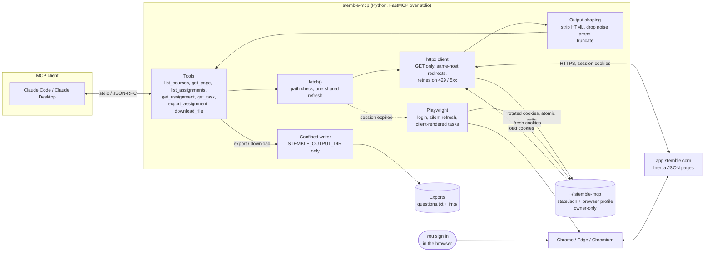

<p align="center">
  
</p>

<h1 align="center">stemble-mcp</h1>

<p align="center">Unofficial, read-only MCP server for reading your Stemble coursework.</p>

<p align="center">
  
  
  
  
  
  
  
  
</p>

An MCP server that lets an AI assistant read your Stemble coursework: courses, assignments, tasks and lab files. It works with Claude Code, Claude Desktop and any other MCP client.

This project is unofficial and is not affiliated with or endorsed by Stemble. It uses your own logged-in session and reads the same pages you can see in your browser.

## Academic integrity

Follow your course's academic integrity and AI-use policies. Many courses restrict or prohibit AI assistance. Check your syllabus and ask your instructor if you are unsure. You are responsible for how you use this tool.

## Architecture



Reading it left to right: your assistant calls a tool, `fetch()` validates the path and hands it to the httpx client, which sends a GET to Stemble with the saved cookies. Results are slimmed down before they go back to the assistant. If Stemble says the session is gone, a headless Playwright browser tries to restore it from the saved profile, and `stemble-mcp login` is the manual fallback. Only `export_assignment` and `download_file` write to disk, and only inside `STEMBLE_OUTPUT_DIR`.

## Tech

| Piece | Used for |
|---|---|
| Python 3.11+ | The whole server |
| FastMCP (`mcp` SDK) | MCP tool definitions and the stdio transport |
| httpx | Authenticated GET requests, cookie jar, retries |
| Inertia.js pages | Stemble serves page data as JSON when asked with `X-Inertia` headers |
| Playwright with Chrome, Edge or Chromium | Interactive login, headless session refresh, older client-rendered question types |
| uv and hatchling | Install, run and packaging (`uvx` runs it with no setup) |
| pytest | Tests for path confinement, host checks and text cleanup |

## Tools

| Tool | What it does |
|---|---|
| `list_courses` | Your courses and ids from the dashboard |
| `get_page` | Data for any Stemble path, e.g. `/courses/123/materials`. `raw=True` returns the full JSON |
| `list_assignments` | Assignments in a course with due dates and status |
| `get_assignment` | Assignment overview: tasks, due date, grade |
| `get_task` | Full task content: question text, inputs, your saved response |
| `export_assignment` | Writes every task of an assignment to a text file, plus images |
| `download_file` | Downloads an authenticated file (lab manual, task file) |

## Design

- **Read-only toward Stemble.** Every request is a GET. The server never saves or submits answers. You answer in Stemble yourself.
- **Local writes are confined.** Exports and downloads can only be written inside `STEMBLE_OUTPUT_DIR`, and downloads are limited to common document and image extensions.
- **Same-host only.** Paths must be Stemble-relative, and redirects are never followed to another host. Embedded images from other hosts are fetched without your cookies and only from public https addresses.
- **No passwords.** You sign in yourself in a real browser window. The server only keeps the resulting session cookies, in files readable only by you.
- After login it runs over plain HTTP. A headless browser is used only to refresh an expired session and to render the older client-side question types.

## Install

Requires [uv](https://docs.astral.sh/uv/) and Python 3.11+. You also need Google Chrome or Edge, or run `uvx playwright install chromium`.

### Claude Code

```bash
claude mcp add stemble -- uvx --from git+https://github.com/A12N4V/stemble-mcp stemble-mcp
```

### Claude Desktop

Add this to `claude_desktop_config.json` (macOS: `~/Library/Application Support/Claude/`, Windows: `%APPDATA%\Claude\`):

```json
{
  "mcpServers": {
    "stemble": {
      "command": "uvx",
      "args": ["--from", "git+https://github.com/A12N4V/stemble-mcp", "stemble-mcp"]
    }
  }
}
```

If Claude Desktop cannot find `uvx`, use its full path from `which uvx` (macOS and Linux) or `where uvx` (Windows).

## First-time login

```bash
uvx --from git+https://github.com/A12N4V/stemble-mcp stemble-mcp login
```

A browser window opens. Sign in yourself. The window closes when you are in. The session is saved and refreshed automatically. Run the command again if the server reports an expired session.

## Configuration

| Variable | Default | Purpose |
|---|---|---|
| `STEMBLE_BROWSER_PATH` | auto | Browser executable. Otherwise it tries system Chrome, then Edge, then Playwright's Chromium |
| `STEMBLE_OUTPUT_DIR` | `~/stemble-exports` | The only place `export_assignment` and `download_file` can write |
| `STEMBLE_HOME` | `~/.stemble-mcp` | Session state and browser profile |

Set them with `claude mcp add -e STEMBLE_OUTPUT_DIR=/path ...` or an `"env"` block in the Desktop config.

## Security

`state.json` and the browser profile in `STEMBLE_HOME` hold your session cookies. Treat them like a password and never commit or share them. The server creates them with owner-only permissions.

Page content comes from Stemble and could in principle contain text aimed at your AI assistant. The path confinement above limits what such text could make the server do, but review what your assistant proposes to do with exported files.

## Development

```bash
git clone https://github.com/A12N4V/stemble-mcp
cd stemble-mcp
uv run --with pytest python -m pytest
```

## License

MIT
